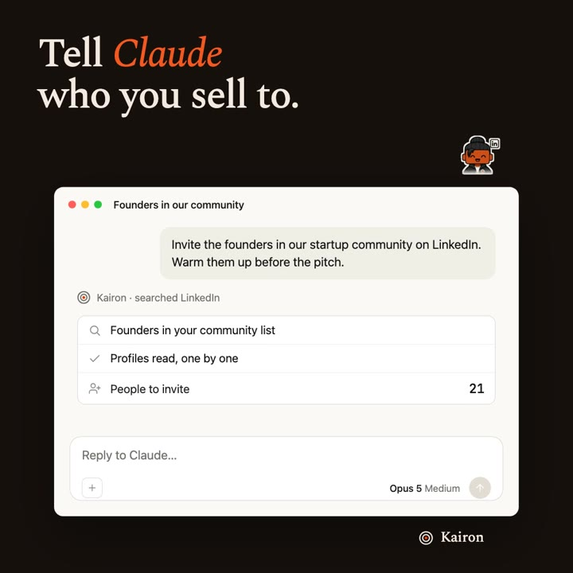

# Startup Product Skills

Agent skills for founders and small teams who own the outcome, not just the merge. There are 11:
ship a feature and prove it moved a number, find the customers who will buy, launch with a page
and a video that show the real product, and teach your market with videos people find.

Each skill is a workflow learned on real work, with the rules that came out of its mistakes. They
are not one-off prompts. Several come from building and launching [Kairon](https://heykairon.com)
in 2026. They are written for [Claude Code](https://claude.com/claude-code) and install into any agent
that runs skills.

<p>
  <a href="skills/product-launch-video/examples/kairon-launch.mp4"></a>
  <a href="https://youtu.be/pio_TsNUXNQ"></a>
</p>

*Left: a 36 s launch video made with `product-launch-video`. Right: an 8:51 explainer made with
`explainer-video`. Click to watch.*

## Skills

### Product: ship as the owner of the outcome

| Skill | What it does |
|---|---|
| [`build-feature`](skills/build-feature/) | Idea to merged PR in 15 steps. Grill the design before the plan, define and instrument the success metric before building, build in parallel, then measure the lift. It is not done until the number moves, or you know why it did not. |
| [`review-loop`](skills/review-loop/) | Review your branch against a strict maintainability and testing rubric, fix, and review again until a round finds nothing Critical or Major. A fresh reviewer every round, a 3-round cap. |

### Growth: find who to target, what to give them, and in what order

| Skill | What it does |
|---|---|
| [`icp-definition`](skills/icp-definition/) | A sharp ICP reverse-engineered from your best customers' public data, with fit and timing signals mapped to real searches, a lookalike list and honest "tribe" ice-breakers. |
| [`lead-magnet`](skills/lead-magnet/) | A lead magnet built from your core offer, biased to a done-for-you artifact made from each prospect's own public data, designed as an engine an agent runs across a list. |
| [`gtm-roadmap`](skills/gtm-roadmap/) | Your ICP and lead magnet turned into a sequenced outreach plan, warmest leads first, with a message and an autonomy level per wave and a first move this week. |
| [`radar-de-rondas-latam`](skills/radar-de-rondas-latam/) | A weekly radar of LATAM startup funding rounds (in Spanish), consolidated into a ledger that flags companies in expansion mode for prospecting. In a six-week test it found 31 rounds; the best single source found 17. |

The first three are a chain: **`icp-definition` → `lead-magnet` → `gtm-roadmap`**.

### Launch: show what the product really does

| Skill | What it does |
|---|---|
| [`landing-page`](skills/landing-page/) | A home page with the copy written and fact-checked as a document first, the real product working in the fold, an optional mascot with one job, and a design judge scoring it until 8/10. |
| [`product-launch-video`](skills/product-launch-video/) | A 15-45 s launch video in Remotion that rebuilds the real product's screens as animated components cut to music. Strict honesty rules; motion and loudness measured. |
| [`omni-video-ads`](skills/omni-video-ads/) | Short video ads generated with Google's Gemini Omni Flash, with a cost guard and your real footage cut in, then one cut per placement (Reels, TikTok, Shorts, feed) with exact text and frame-level QC. |

### Content: teach your market something true, and get it found

| Skill | What it does |
|---|---|
| [`explainer-video`](skills/explainer-video/) | A Kurzgesagt-style educational video (8-10 min, any language): a fact-checked sources sheet, a script edited in rounds, images from the cheapest source you have, voice and music picked from samples, an edit to measured targets. |
| [`youtube-seo`](skills/youtube-seo/) | The publish package for YouTube: searched phrases from YouTube's own autocomplete, a benchmark of the most-viewed similar videos, titles, description, chapters, captions and thumbnails, checked against YouTube's official limits. |

## What they share

- **Real data over invention.** Every number on a page, in a video or in a brief comes from a
  source, and each claim says where. When the data is missing, the skill asks, leaves the field
  empty, or marks the line as an assumption. It never makes the data up.
- **A judge that is not the author.** Code, plans and designs are reviewed by a fresh subagent that
  did not make them, round after round, against a written bar (8/10 for design).
- **Measure, do not guess.** A success metric before the build, motion and loudness on every
  render, YouTube's own autocomplete instead of a keyword tool's guess. The agent cannot watch a
  video or hear a mix, so it measures them.
- **Money and taste stay with you.** The skills that generate images, voice, music or video stop
  for your OK on the cost first. Taste calls come back as samples for you to pick. The video skills
  hand you the files; publishing is your call.

## Install

With the [`skills`](https://github.com/vercel-labs/skills) CLI (Claude Code, Cursor, Codex,
OpenCode and more):

```bash
# one skill
npx skills add maleonro/startup-product-skills --skill build-feature

# a chain
npx skills add maleonro/startup-product-skills --skill icp-definition --skill lead-magnet --skill gtm-roadmap

# list them, or install all of them
npx skills add maleonro/startup-product-skills --list
npx skills add maleonro/startup-product-skills --all
```

Or copy a folder into your skills directory:

```bash
git clone https://github.com/maleonro/startup-product-skills
cp -r startup-product-skills/skills/build-feature ~/.claude/skills/build-feature
# or per project:
cp -r startup-product-skills/skills/build-feature /path/to/repo/.claude/skills/build-feature
```

Then describe the job in plain words ("build this feature", "define our ICP", "make a launch
video") and the matching skill loads. Read a skill's README before its first run: some need an API
key, Remotion or a Python package. The ones that run reviewers or judges need an agent with
subagents, such as Claude Code.

## Philosophy

A builder owns the merge. A product owner owns the outcome. These skills are for the second kind.

## Credits

These skills stand on other people's work:

- **`build-feature`**:
  - The grilling step is **`grill-me`** (and `grill-with-docs`) from [Matt Pocock's skills](https://github.com/mattpocock/skills) (MIT). Resolving every branch of the decision tree before writing code is his idea.
  - The UI review uses Vercel's [`web-design-guidelines`](https://vercel.com/kb/guide/agent-skills-creating-installing-and-sharing-reusable-agent-context) and [`vercel-react-best-practices`](https://github.com/vercel-labs/agent-skills).
- **`review-loop`**: the testing guide is adapted from the testing skill in [Primo's public skills](https://github.com/primo-devs/public-skills).
- **`icp-definition`, `lead-magnet` and `gtm-roadmap`**: built on **Alex Hormozi's** *$100M Offers* and *$100M Leads*.
- **`radar-de-rondas-latam`**: its sources are [LatamList](https://latamlist.com), LatAm Tech Weekly, Brazil Journal, NeoFeed, Finsiders and latamfintech.co.
- **`landing-page`**:
  - The interactive mascot is adapted from [page-mascot](https://github.com/nilbuild/page-mascot) by Kamran Ahmed (MIT).
  - The design judge's bar was set by the designer-founder of [Ato](https://heyato.ai/launch).
- **`product-launch-video` and `explainer-video`**: built on [Remotion](https://www.remotion.dev). Its license is free for individuals and companies with up to 3 employees.
- **`omni-video-ads`**: runs on Google's Gemini Omni Flash.
- **`explainer-video`**:
  - It takes its bar from **[Kurzgesagt – In a Nutshell](https://kurzgesagt.org)** (not affiliated or endorsed).
  - The editor's rules come from Richard E. Mayer's multimedia learning principles and Dahlstrom (*PNAS*, 2014).
  - **Claude** (Anthropic) made its first video in Claude Code, then wrote `explainer-video` and `youtube-seo` from that work.
  - The other tools it used, such as Higgsfield, ElevenLabs, Grok, Whisper and Kenney's CC0 sounds, are credited in [its README](skills/explainer-video/README.md#credits).
- **Distribution**: via [`npx skills`](https://github.com/vercel-labs/skills), the open agent-skills tool by Vercel Labs.
