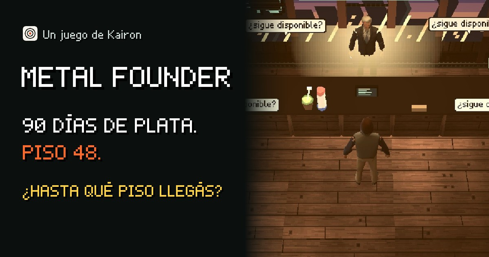

# browser-game

A [Claude Code](https://claude.com/claude-code) skill that builds a short browser game with coding
agents, from a one-page brief to a launch you can measure. Any genre, 5-15 minutes, phone first,
a static build on any static host. It works for an indie game or a branded one, where each idea a
company wants to teach becomes a mechanic.

It is not a game engine. It is the process around one: what to decide before the code, how to make
a game an agent can play and test, how to playtest without players, and how to launch it.

## Example

[](https://juego.heykairon.com)

[Metal Founder](https://juego.heykairon.com) (Spanish), a PS1-style stealth game made for
[Kairon](https://heykairon.com) in October 2026 (click to play). You are a founder with 90 days of
cash left, and the CEO you need is on floor 48. Each floor is a common sales mistake. It runs in
three.js on a phone or a computer.

| | |
|---|---|
| Brief to version 23 | about 4.5 days |
| Model use | 1,444 M tokens in 7,390 calls to Claude Opus and Sonnet; about US$620 at API prices |
| Of those tokens | 97% re-read context; 9 M were written |
| Generated art | 58 Higgsfield credits: textures and 4 characters, image to 3D |
| First week live | 12 people opened it, 7 started, 1 finished |
| Phones in the first funnel | 6 of 6 opened in portrait |

Every rule in the skill is a correction made on this game.

## The thesis

- **An agent cannot play a game, so the game must be playable by a script.** A deterministic step,
  a text dump of the state and debug hooks come first. Then an autopilot proves the game can be
  finished, a bot measures taps and frozen seconds, and the trailer is shot frame by frame.
- **Players do not read.** One player failed a question twice with its definition written in it.
  Analytics showed every dialogue read to the last line, and still the goal did not stick. Explain
  each idea just before it is needed, keep the goal on screen, and use plain words. The owner
  played a version with parody brand names and wanted to buy the parodies.
- **Judges that are not the author, and players that are not real, before players that are.** A
  game-design judge works with Jesse Schell's lenses and Nir Eyal's hook test. A fresh synthetic
  player answers "who am I, what is the goal, how am I doing" at four checkpoints. They are cheap
  and fast, but 3 real people playing before the code would have changed the first plan most.
- **The phone opens upright.** Every phone in the first funnel did. Landscape, touch controls and a
  portrait screen that sells the game are day-1 work, not a later version.

## What it does

1. **Brief**: the essential experience in one sentence, the player and their device, the owner's
   goal, the legal lines (mechanics yes, assets no), and the bar (Poki: plays over 3 minutes).
2. **Research**: a cheatsheet of sourced tips for the genre, and a clean-room note if a classic is
   the model.
3. **Core and hooks**: rules with no renderer, `advanceTime(ms)`, `render_game_to_text()`, an
   autopilot to the ending, and "by hand" browser tests that only use real keys.
4. **Renderer and controls**: keyboard and touch, full-screen landscape, a prewarmed first frame.
5. **Look**: one era pushed hard, an audit of defects with photos, generated art under a quoted cap.
6. **The version loop**: a PRD with every fact sourced, the design judge, a synthetic player, the
   build split across agents with disjoint files, the same measures before and after.
7. **Launch**: an analytics funnel, a deploy the owner runs, a share card, a result grid like
   Wordle's.
8. **Trailer**: shot from the game through its debug hooks, cut to a free recording of a famous
   piece, judged from contact sheets until 8/10.

No paid step runs without the owner's OK on the exact cost, and the owner runs every deploy.

## Requirements

- Claude Code, or another agent that runs skills and subagents. The strongest model directs; a
  cheaper one builds.
- Node.js. The first game used Vite, TypeScript, three.js, Vitest and Playwright; the process does
  not depend on them.
- A static host (Cloudflare Pages, Netlify, GitHub Pages) and a product-analytics tool (PostHog on
  the first game).
- Optional: an image and image-to-3D API (Higgsfield on the first game), and
  [Remotion](https://www.remotion.dev) for the trailer, with Python 3 and ffmpeg for its measures.

## Files

- [`SKILL.md`](SKILL.md): hard rules and the 10-step checklist.
- [`references/brief.md`](references/brief.md): the brief, mapping ideas to mechanics, legal lines,
  the cheatsheet.
- [`references/build.md`](references/build.md): core first, the debug hooks, the tests, measures,
  phone, agents in parallel.
- [`references/art.md`](references/art.md): the look, the audit, generated art and its costs, sound.
- [`references/playtest.md`](references/playtest.md): the version loop, the theory file, playtest
  agents, the synthetic player, the PRD.
- [`references/judge.md`](references/judge.md): the game-design judge's prompt.
- [`references/launch.md`](references/launch.md): the funnel, deploy, the share card, the result
  grid, the launch post.
- [`references/trailer.md`](references/trailer.md): capture, free music, the beat grid, the judge.
- [`scripts/check-dist.mjs`](scripts/check-dist.mjs): fails the build if a reference or raw art file
  ships, even renamed.
- [`examples/share-card.jpg`](examples/share-card.jpg): the first game's link preview.

## Install

```bash
npx skills add maleonro/startup-product-skills --skill browser-game
# optional: the design judge for the trailer, and Remotion notes
npx skills add maleonro/startup-product-skills --skill landing-page
npx skills add maleonro/startup-product-skills --skill product-launch-video
```

Then ask Claude Code for a browser game, a branded game, or a game "like" a classic you name.

## Credits

- The theory the playtests use: Jesse Schell, *The Art of Game Design* (lens questions quoted from
  schellgames.com); Celia Hodent, *The Gamer's Brain*; Steve Swink, *Game Feel*; Winifred Phillips,
  *A Composer's Guide to Game Music*; Nir Eyal, *Hooked*; and Poki's developer guides.
- The first trailer's music: "Russian Dance" from *The Nutcracker* (Tchaikovsky), recorded by
  Philip Milman (Lud and Schlatt's Musical Emporium), CC BY 3.0, via Wikimedia Commons.
- **[Claude](https://claude.com)** by Anthropic made the first game in Claude Code, with Claude Opus
  directing and Claude Sonnet building, and wrote this skill from that work.
